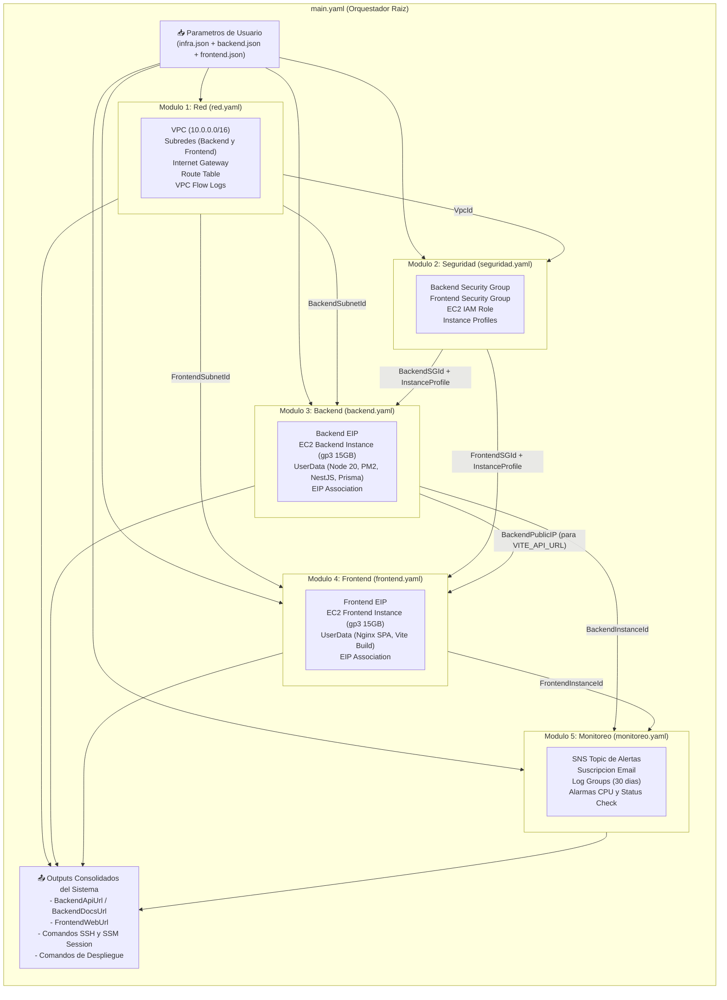
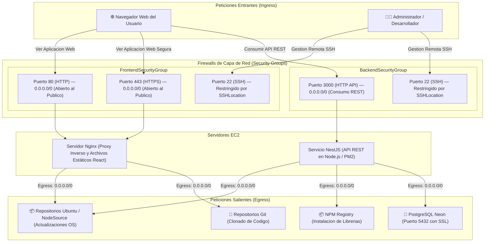
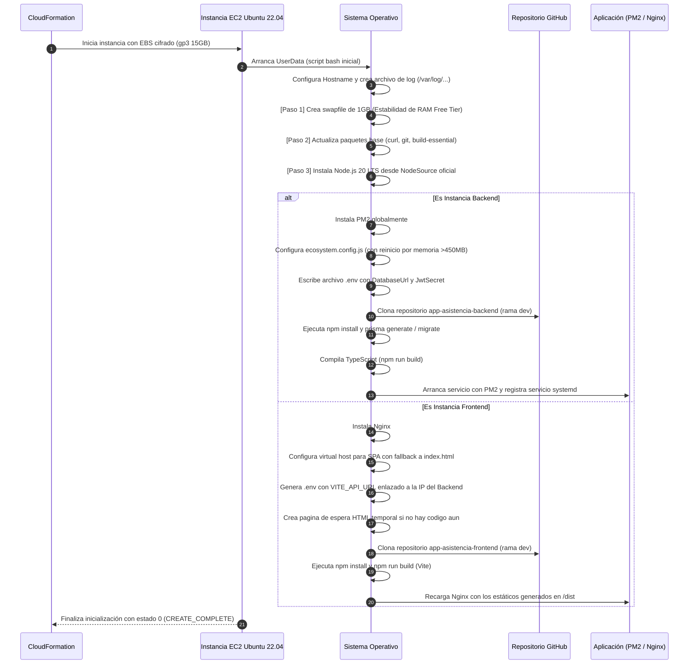
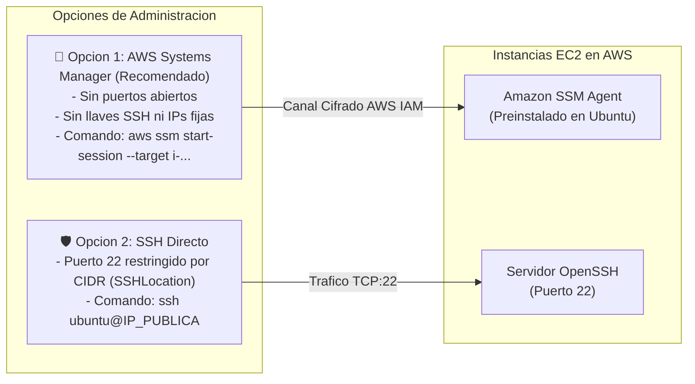

# Arquitectura Visual de Infraestructura — Sistema de Asistencia

Este documento presenta una guía visual completa de la infraestructura aprovisionada en **AWS CloudFormation**, sus componentes, cómo se relacionan entre sí y cómo fluyen los datos y la seguridad a través del sistema.

---

## 1. Diagrama General de Arquitectura en AWS

El siguiente diagrama ilustra la topología de red en la región `us-east-2`, la VPC, las subredes aisladas, las instancias de cómputo EC2 con sus IPs Elásticas y las conexiones externas con la base de datos PostgreSQL Neon y los usuarios:

```mermaid
graph TD
    subgraph Internet["🌐 Internet Pública"]
        Users["👥 Usuarios Web (Navegador)"]
        Admin["💻 Administrador (DevOps / SSH / SSM)"]
        NeonDB[("🐘 PostgreSQL Neon DB (Externo Cloud)\nPuerto 5432 con SSL")]
        GitBack["🐙 Repositorio Git Backend\napp-asistencia-backend.git (rama dev)"]
        GitFront["🐙 Repositorio Git Frontend\napp-asistencia-frontend.git (rama dev)"]
    end

    subgraph AWS_Cloud["☁️ AWS Cloud — Region us-east-2"]
        subgraph VPC["VPC: vpc-asistencia-dev (10.0.0.0/16)"]
            IGW["🚪 Internet Gateway (igw-asistencia-dev)"]
            RT["🛣️ Public Route Table (0.0.0.0/0 -> IGW)"]

            subgraph SubnetFront["Subred Frontend (10.0.2.0/24)"]
                EIP_Front["📌 Elastic IP Frontend\n(IP Publica Estatica)"]
                SG_Front["🛡️ SG Frontend\nIn: 80 (HTTP), 443 (HTTPS), 22 (SSH)\nOut: Todo"]
                VM_Front["🖥️ EC2 Frontend: vm-asistencia-frontend-dev\nUbuntu 22.04 LTS (t3.micro)\nNginx Web Server + Vite React Build"]
            end

            subgraph SubnetBack["Subred Backend (10.0.1.0/24)"]
                EIP_Back["📌 Elastic IP Backend\n(IP Publica Estatica)"]
                SG_Back["🛡️ SG Backend\nIn: 3000 (API NestJS), 22 (SSH)\nOut: Todo"]
                VM_Back["🖥️ EC2 Backend: vm-asistencia-backend-dev\nUbuntu 22.04 LTS (t3.micro)\nNode.js 20 + PM2 + NestJS + Prisma"]
            end

            FlowLog["📊 VPC Flow Logs\nAuditoria de trafico de red"]
        end

        subgraph IAM_Sec["🔐 Identidad y Acceso (IAM)"]
            Role_EC2["🔑 EC2InstanceRole\nSSMManagedInstanceCore\nCloudWatchAgentServerPolicy"]
            Profile_Back["Profile EC2 Backend"]
            Profile_Front["Profile EC2 Frontend"]
            Role_Flow["Role VPC Flow Logs"]
        end

        subgraph Observability["📈 Observabilidad y Notificaciones"]
            CW_Log_Flow["📁 LogGroup: /aws/vpc-flow-logs"]
            CW_Log_Back["📁 LogGroup: /aws/ec2/asistencia-backend"]
            CW_Log_Front["📁 LogGroup: /aws/ec2/asistencia-frontend"]
            Alarm_CPU_B["⏰ Alarma CPU Backend > 80%"]
            Alarm_CPU_F["⏰ Alarma CPU Frontend > 80%"]
            Alarm_Status_B["⏰ Alarma Estado Físico Backend"]
            Alarm_Status_F["⏰ Alarma Estado Físico Frontend"]
            SNS_Topic["📢 SNS Topic: topic-alerts-asistencia-dev"]
            Email_Alert["✉️ Notificacion Email (AlertEmail)"]
        end
    end

    %% Conexiones de Entrada
    Users -->|"HTTP:80"| EIP_Front
    EIP_Front --> VM_Front
    Users -->|"HTTP:3000 /api/v1"| EIP_Back
    EIP_Back --> VM_Back
    Admin -->|"SSH:22"| EIP_Back
    Admin -->|"SSH:22"| EIP_Front
    Admin -->|"SSM Session (Sin puertos abiertos)"| Role_EC2

    %% Enrutamiento Interno VPC
    IGW --- RT
    RT --- SubnetFront
    RT --- SubnetBack

    %% Conexiones Salientes
    VM_Back -->|"TCP:5432 (SSL)"| NeonDB
    VM_Back -->|"Git Clone / NPM"| GitBack
    VM_Front -->|"Git Clone / NPM"| GitFront

    %% Seguridad IAM
    Role_EC2 --> Profile_Back
    Role_EC2 --> Profile_Front
    Profile_Back --> VM_Back
    Profile_Front --> VM_Front
    Role_Flow --> FlowLog

    %% Telemetria y Alertas
    FlowLog --> CW_Log_Flow
    VM_Back -.->|"Metricas"| Alarm_CPU_B
    VM_Back -.->|"Salud"| Alarm_Status_B
    VM_Front -.->|"Metricas"| Alarm_CPU_F
    VM_Front -.->|"Salud"| Alarm_Status_F
    Alarm_CPU_B --> SNS_Topic
    Alarm_CPU_F --> SNS_Topic
    Alarm_Status_B --> SNS_Topic
    Alarm_Status_F --> SNS_Topic
    SNS_Topic --> Email_Alert
```

---

## 2. Grafo de Dependencias y Relación entre Módulos

El orquestador principal (`main.yaml`) coordina 5 plantillas anidadas con **Bajo Acoplamiento**. Ningún módulo hijo depende internamente de otro; la inyección de salidas se realiza a través de contratos claros de `Outputs` $\rightarrow$ `Parameters`:

---

## 3. Matriz Contractual de Conexión entre Módulos

Esta tabla describe con exactitud qué información produce cada módulo y qué otro módulo la consume:

| Módulo Origen | Salida (`Output`) | Módulo Destino | Parámetro de Entrada (`Parameter`) | Propósito de la Conexión |
|---|---|---|---|---|
| `red.yaml` | `VpcId` | `seguridad.yaml` | `VpcId` | Asocia los Security Groups a la VPC correcta |
| `red.yaml` | `BackendSubnetId` | `backend.yaml` | `SubnetId` | Ubica la VM del backend en la subred 10.0.1.0/24 |
| `red.yaml` | `FrontendSubnetId` | `frontend.yaml` | `SubnetId` | Ubica la VM del frontend en la subred 10.0.2.0/24 |
| `seguridad.yaml` | `BackendSecurityGroupId` | `backend.yaml` | `SecurityGroupId` | Aplica firewall al backend (SSH:22, API:3000) |
| `seguridad.yaml` | `FrontendSecurityGroupId` | `frontend.yaml` | `SecurityGroupId` | Aplica firewall al frontend (SSH:22, Web:80/443) |
| `seguridad.yaml` | `BackendInstanceProfileName` | `backend.yaml` | `IamInstanceProfile` | Otorga permisos SSM y CloudWatch a la VM Backend |
| `seguridad.yaml` | `FrontendInstanceProfileName` | `frontend.yaml` | `IamInstanceProfile` | Otorga permisos SSM y CloudWatch a la VM Frontend |
| `backend.yaml` | `BackendPublicIP` | `frontend.yaml` | `BackendPublicIP` | Configura `VITE_API_URL` en Nginx/React apuntando al API |
| `backend.yaml` | `BackendInstanceId` | `monitoreo.yaml` | `BackendInstanceId` | Vincula alarmas CloudWatch de CPU y salud al Backend |
| `frontend.yaml` | `FrontendInstanceId` | `monitoreo.yaml` | `FrontendInstanceId` | Vincula alarmas CloudWatch de CPU y salud al Frontend |

---

## 4. Perímetro de Red y Seguridad (Firewall / Security Groups)

---

## 5. Ciclo de Vida del Aprovisionamiento (UserData en Arranque)

Cuando CloudFormation instancia las máquinas virtuales, cada una ejecuta su script de inicialización (`UserData`) de forma desatendida y automática:

---

## 6. Inventario Completo de Recursos Aprovisionados

A continuación se detalla cada uno de los **31 recursos lógicos** gestionados por la arquitectura:

### Módulo 1: Red (`plantillas/red.yaml`) — 11 Recursos

| Recurso Lógico | Tipo de Recurso AWS | Nombre Físico / Identificador | Propósito Arquitectónico |
|---|---|---|---|
| `VPC` | `AWS::EC2::VPC` | `vpc-asistencia-dev` | Red privada virtual aislada con bloque CIDR `10.0.0.0/16` |
| `InternetGateway` | `AWS::EC2::InternetGateway` | `igw-asistencia-dev` | Pasarela para permitir tráfico bidireccional entre la VPC e Internet |
| `VPCGatewayAttachment` | `AWS::EC2::VPCGatewayAttachment` | *(Asociación VPC-IGW)* | Conecta el Internet Gateway a la VPC |
| `PublicRouteTable` | `AWS::EC2::RouteTable` | `rt-public-asistencia-dev` | Tabla de rutas principal para dirigir el tráfico público |
| `DefaultPublicRoute` | `AWS::EC2::Route` | *(Ruta 0.0.0.0/0)* | Dirige todo el tráfico no local de la VPC hacia el Internet Gateway |
| `BackendSubnet` | `AWS::EC2::Subnet` | `subnet-asistencia-backend-dev` | Subred dedicada al Backend con bloque CIDR `10.0.1.0/24` |
| `FrontendSubnet` | `AWS::EC2::Subnet` | `subnet-asistencia-frontend-dev` | Subred dedicada al Frontend con bloque CIDR `10.0.2.0/24` |
| `BackendSubnetRouteTableAssociation` | `AWS::EC2::SubnetRouteTableAssociation` | *(Asociación)* | Vincula la subred del backend a la tabla de rutas pública |
| `FrontendSubnetRouteTableAssociation` | `AWS::EC2::SubnetRouteTableAssociation` | *(Asociación)* | Vincula la subred del frontend a la tabla de rutas pública |
| `VPCFlowLogGroup` | `AWS::Logs::LogGroup` | `/aws/vpc-flow-logs/asistencia-dev` | Grupo de logs de CloudWatch con retención de 30 días para auditoría |
| `VPCFlowLogRole` | `AWS::IAM::Role` | `role-vpc-flow-logs-asistencia-dev` | Rol IAM con permisos para que VPC Flow Logs escriba en CloudWatch |
| `VPCFlowLog` | `AWS::EC2::FlowLog` | `flow-log-asistencia-dev` | Capturador de telemetría de red que registra tráfico aceptado/rechazado |

---

### Módulo 2: Seguridad e Identidad (`plantillas/seguridad.yaml`) — 5 Recursos

| Recurso Lógico | Tipo de Recurso AWS | Nombre Físico / Identificador | Propósito Arquitectónico |
|---|---|---|---|
| `BackendSecurityGroup` | `AWS::EC2::SecurityGroup` | `sg-asistencia-backend-dev` | Firewall: Permite SSH (22) desde IP autorizada y API (3000) a Internet |
| `FrontendSecurityGroup` | `AWS::EC2::SecurityGroup` | `sg-asistencia-frontend-dev` | Firewall: Permite SSH (22), HTTP (80) y HTTPS (443) a Internet |
| `EC2InstanceRole` | `AWS::IAM::Role` | `role-ec2-asistencia-dev` | Rol IAM asumido por las instancias EC2 con políticas SSM y CloudWatch |
| `BackendInstanceProfile` | `AWS::IAM::InstanceProfile` | `profile-ec2-asistencia-backend-dev` | Perfil de instancia IAM adjuntado a la máquina virtual Backend |
| `FrontendInstanceProfile` | `AWS::IAM::InstanceProfile` | `profile-ec2-asistencia-frontend-dev` | Perfil de instancia IAM adjuntado a la máquina virtual Frontend |

---

### Módulo 3: Cómputo Backend (`plantillas/backend.yaml`) — 3 Recursos

| Recurso Lógico | Tipo de Recurso AWS | Nombre Físico / Identificador | Propósito Arquitectónico |
|---|---|---|---|
| `BackendEIP` | `AWS::EC2::EIP` | `eip-asistencia-backend-dev` | Dirección IP pública estática e inmutable para el servidor backend |
| `BackendInstance` | `AWS::EC2::Instance` | `vm-asistencia-backend-dev` | Servidor EC2 Ubuntu 22.04 LTS (t3.micro), EBS gp3 15GB cifrado con IMDSv2 |
| `BackendEIPAssociation` | `AWS::EC2::EIPAssociation` | *(Asociación)* | Asigna la IP elástica a la interfaz de red de la instancia Backend |

---

### Módulo 4: Cómputo Frontend (`plantillas/frontend.yaml`) — 3 Recursos

| Recurso Lógico | Tipo de Recurso AWS | Nombre Físico / Identificador | Propósito Arquitectónico |
|---|---|---|---|
| `FrontendEIP` | `AWS::EC2::EIP` | `eip-asistencia-frontend-dev` | Dirección IP pública estática e inmutable para el servidor frontend |
| `FrontendInstance` | `AWS::EC2::Instance` | `vm-asistencia-frontend-dev` | Servidor EC2 Ubuntu 22.04 LTS (t3.micro), EBS gp3 15GB cifrado con IMDSv2 |
| `FrontendEIPAssociation` | `AWS::EC2::EIPAssociation` | *(Asociación)* | Asigna la IP elástica a la interfaz de red de la instancia Frontend |

---

### Módulo 5: Observabilidad y Monitoreo (`plantillas/monitoreo.yaml`) — 8 Recursos

| Recurso Lógico | Tipo de Recurso AWS | Nombre Físico / Identificador | Propósito Arquitectónico |
|---|---|---|---|
| `AlertsTopic` | `AWS::SNS::Topic` | `topic-alerts-asistencia-dev` | Canal de mensajería SNS para distribución inmediata de alertas críticas |
| `AlertsSubscription` | `AWS::SNS::Subscription` | *(Suscripción Email)* | Suscribe el email del administrador (`AlertEmail`) al tópico SNS |
| `BackendLogGroup` | `AWS::Logs::LogGroup` | `/aws/ec2/asistencia-backend-dev` | Almacén de logs de CloudWatch para el backend (retención de 30 días) |
| `FrontendLogGroup` | `AWS::Logs::LogGroup` | `/aws/ec2/asistencia-frontend-dev` | Almacén de logs de CloudWatch para el frontend (retención de 30 días) |
| `BackendCPUAlarm` | `AWS::CloudWatch::Alarm` | `alarm-ec2-cpu-high-backend-asistencia-dev` | Alerta si el uso promedio de CPU del backend supera el 80% por 5 min |
| `FrontendCPUAlarm` | `AWS::CloudWatch::Alarm` | `alarm-ec2-cpu-high-frontend-asistencia-dev` | Alerta si el uso promedio de CPU del frontend supera el 80% por 5 min |
| `BackendStatusCheckAlarm` | `AWS::CloudWatch::Alarm` | `alarm-ec2-status-failed-backend-asistencia-dev` | Alerta si falla el chequeo de hardware o SO de la VM Backend |
| `FrontendStatusCheckAlarm` | `AWS::CloudWatch::Alarm` | `alarm-ec2-status-failed-frontend-asistencia-dev` | Alerta si falla el chequeo de hardware o SO de la VM Frontend |

---

### Orquestador Raíz (`plantillas/main.yaml`) — 5 Recursos Anidados

| Recurso Lógico | Tipo de Recurso AWS | Archivo Hijo Referenciado | Propósito Arquitectónico |
|---|---|---|---|
| `RedStack` | `AWS::CloudFormation::Stack` | `./red.yaml` | Instancia y aprovisiona toda la infraestructura de red |
| `SeguridadStack` | `AWS::CloudFormation::Stack` | `./seguridad.yaml` | Instancia firewalls y roles IAM recibiendo `VpcId` |
| `BackendStack` | `AWS::CloudFormation::Stack` | `./backend.yaml` | Instancia el backend recibiendo la subred y security group |
| `FrontendStack` | `AWS::CloudFormation::Stack` | `./frontend.yaml` | Instancia el frontend recibiendo la subred, security group e IP del backend |
| `MonitoreoStack` | `AWS::CloudFormation::Stack` | `./monitoreo.yaml` | Instancia alertas SNS y CloudWatch recibiendo los IDs de ambas VMs |

---

## 7. Diagrama de Flujo de Operación y Conectividad Administrativa

---

## Resumen Ejecutivo

* **Total de recursos individuales gestionados:** 31 recursos en AWS.
* **Capas arquitectónicas:** Red, Seguridad/IAM, Cómputo Backend, Cómputo Frontend y Observabilidad.
* **Seguridad por diseño:** Cifrado EBS activado, IMDSv2 obligatorio, roles de mínimo privilegio, SSH restringido y SSM Session Manager habilitado.
* **Costos garantizados:** 100% elegible para la capa gratuita de AWS (**Free Tier**) utilizando instancias `t3.micro`, retención de logs limitada a 30 días y base de datos serverless externa Neon.
